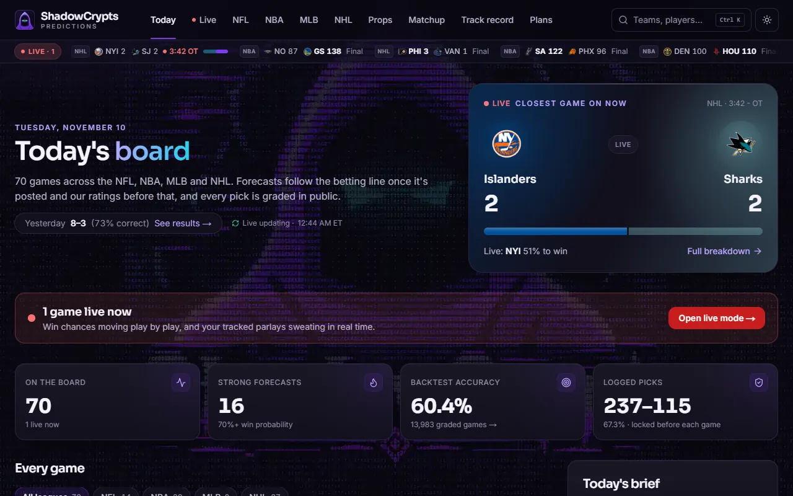
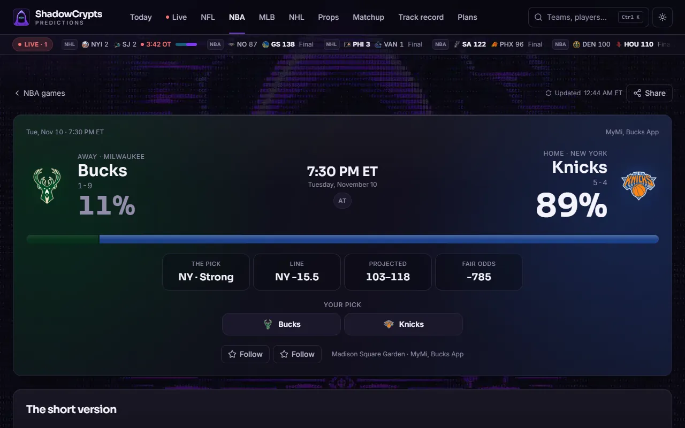
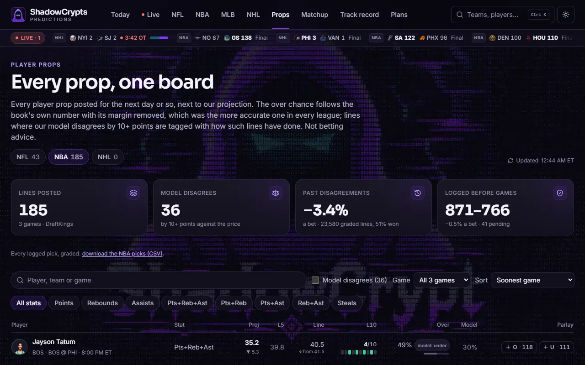
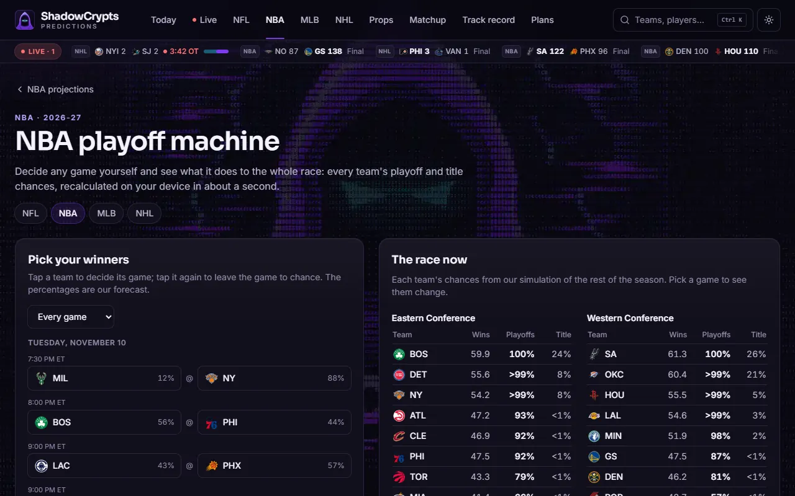
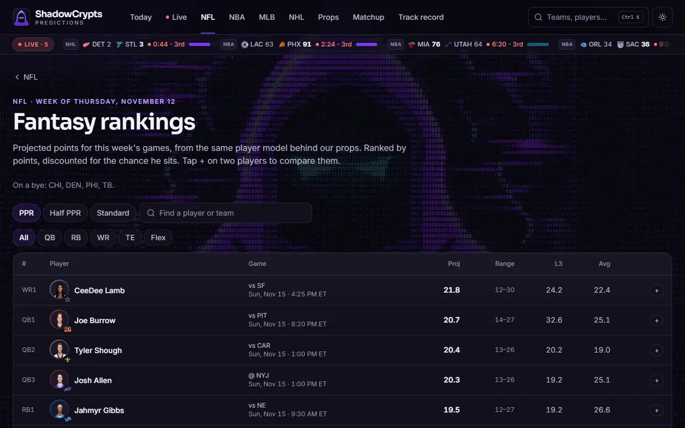
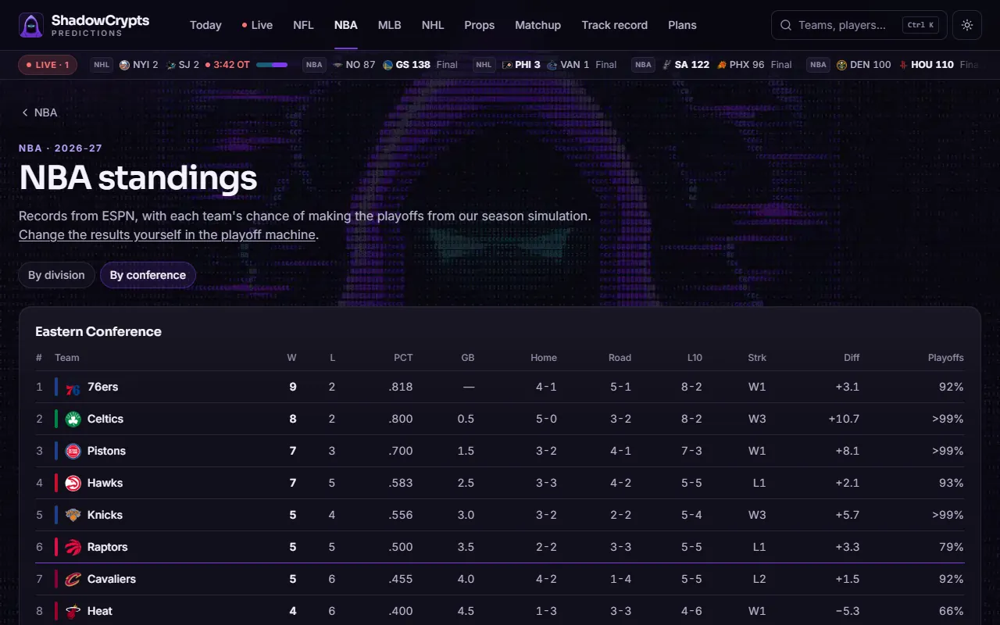
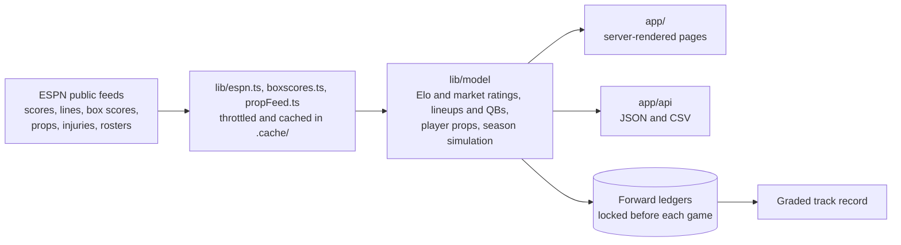

<p align="center">
  
</p>

<h1 align="center">ShadowCrypts Predictions</h1>

<p align="center">
  Win probabilities, player props, fantasy rankings and a public, graded track record for every NFL, NBA, MLB and NHL game:<br>
  built on free public data, tested against the betting market, and honest about where it loses.
</p>

<p align="center"><strong>Live: <a href="https://shadowcrypts.com">shadowcrypts.com</a></strong></p>

<p align="center">
  <a href="https://github.com/ShadowCrypts/shadowcrypts-predictions/actions/workflows/ci.yml"></a>
  
  
  
  
</p>

| | |
| --- | --- |
|  |  |
|  |  |
|  |  |

## What it is

A self-hosted sports forecasting site, about 40,000 lines of code (almost all TypeScript), built to see how far free public data can go, with one rule: **every claim gets graded in public.** Each model change had to show its worth against the closing betting line, not just the previous model, on seasons it never saw. Several ideas didn't, and the docs say so.

Every game since the 2024 seasons, graded against the forecast the site would have shown before it (as of November 10, 2026). Forecasts have also been locked before each game since October 2026 and graded as they stood: 237–115 so far.

| League | Games | Picked the winner | Log loss |
| --- | ---: | ---: | ---: |
| NFL | 704 | 68.8% | 0.602 |
| NBA | 2,785 | 68.9% | 0.579 |
| MLB | 7,418 | 57.0% | 0.676 |
| NHL | 3,076 | 58.7% | 0.666 |

Those are about what the betting market manages, and that's the point: in testing, **the closing line beat every rating model**, so once a line is posted the forecast follows it with the bookmaker's margin removed. The models' job is everything the line doesn't cover: games before a line is up, players, live games, whole seasons.

## Highlights

- **Forecasts that know the market is the bar.** Elo plus "market-implied" ratings learned from past closing lines blend into a pre-line forecast that beat Elo alone in every league. NBA lineups are rated from box scores, which closed about half the gap to the market on held-out seasons. NFL starting quarterbacks are rated from their own play, which closed most of it, though that test isn't clean: the design changed after a look at the held-out seasons, and the site says so.
- **Player props for three leagues.** Projections from minutes, ice time and target share, set next to the sportsbooks' lines. The book was more accurate in every league, so the site shows the book's chance and logs where the model disagrees, graded forward (a losing record in the NBA, and it says so).
- **Same-game parlays priced honestly.** A Gaussian copula, fitted on how one game's props and result move together. On held-out games, NBA parlays whose legs move together were priced at 34% and hit 34%, where multiplying the legs said 20%.
- **Live everything.** Live win probability and live prop chances, fitted on play-by-play rebuilt period by period. At halftime the live NBA prop chance cut log loss from 0.685 to 0.526. There's a live mode with a sweat meter for tracked parlays, and background push alerts with no account needed.
- **Season simulation in your browser.** The playoff machine re-runs 4,000 seasons on your device when you pick a winner. Common random numbers, one stream per simulation and conference, mean only what your pick changed moves.
- **Fantasy football with receipts.** Weekly rankings with a published backtest: a smaller average miss than each player's own season average in every season on file (5.08 against 5.55 in 2026). There's a start-or-sit number from about 890,000 real pairings, and a forward test locked before each kickoff.
- **The numbers are checked, not trusted.** `npm run datacheck` runs about 29,000 checks of records, scores, rosters, standings, stat leaders and player game logs against ESPN's own feeds, plus arithmetic that has to hold (playoff odds add up to the playoff spots, the track record recounts from its CSV). It's found real bugs: box scores that had drifted from official corrections, and empty rosters that turned off a filter.
- **Built like it's public.** A nonce-based Content Security Policy on every page, per-client and per-endpoint rate limits, one proxy gate for every request, capped request bodies, and a recorded full security audit ([SECURITY.md](SECURITY.md)). Lighthouse scores 100 for accessibility, best practices and SEO on every audited page, and every text color clears WCAG AA in both themes.

**Tried and rejected**, because a portfolio of only wins isn't believable: an NHL goalie save-percentage model, rest and travel effects beyond an NBA time-zone penalty, an "over lean" on prop lines, hit-rate streaks (8 of 10 overs went over 52.8% of the time, the book said 53.2%), better-ATS-record trends (51.2%, short of the 52.4% a bet needs), and mixing a player's season average into the fantasy projection. Each is written up with its numbers in [docs/FEATURES.md](docs/FEATURES.md) or in the methodology section of the site's track record page.

## How it works



No database: everything is JSON on disk in `.cache/`, so the site runs anywhere with a persistent folder. A league's model rebuilds in the background every minute or two, pages get the last build instantly, and a refresher keeps forecasts locking close to game time.

**Stack:** Next.js 16 (App Router, React Server Components), React 19, TypeScript, Tailwind CSS, Web Push (VAPID); `node:test` through tsx, ESLint 9 with the React Compiler rules, Lighthouse and Puppeteer for audits.

## Run it

You need Node.js 20.9 or newer.

```bash
npm install
```

```bash
npm run dev
```

Open http://localhost:3000. The first visit downloads recent seasons from ESPN and answers within about 20 seconds; the full history fills in behind it over about half an hour, and a notice says so meanwhile (`npm run warm` fetches it all up front). Copy `.env.example` to `.env` only if you need its settings.

### Checks

```bash
npm run verify       # type check, lint and every unit test (what CI runs, with the build)
```

```bash
npm run build && npm run start
```

```bash
npm run smoke        # with the server running: about 550 end-to-end checks
```

```bash
npm run datacheck    # with the server running: the numbers against ESPN's feeds
```

```bash
npm run audit        # with the server running: Lighthouse on phone and desktop
```

```bash
npm run visits       # on the server: daily arrivals, where they landed and which sites sent them
```

The visit counts are totals only: no IP addresses, cookies or fingerprints. The site's `/privacy` page says exactly what's kept.

The backtests behind every number on the site are in `scripts/` (`npm run backtest`, with `-- --props`, `-- --fantasy`, `-- --correlations` and more). [docs/OPERATIONS.md](docs/OPERATIONS.md) lists every script, plus hosting and what to back up.

## Project layout

```
app/          pages, components and API routes (Next.js App Router)
lib/          data feeds, caching, security and the models (lib/model)
scripts/      backtests, warm-up, refresher, and the smoke, data and Lighthouse checks
tests/        unit tests (node:test)
docs/         features in detail, running and hosting it, the API, screenshots
public/       service worker, offline page, signature and backdrop images
deploy/       server setup, the update-site command, the service and the Caddy config
assets/, brand/   the ShadowCrypt artwork (not under the code's license)
```

## More

- [docs/FEATURES.md](docs/FEATURES.md): everything the site does, how, and what it was measured against
- [docs/OPERATIONS.md](docs/OPERATIONS.md): setup, every script, hosting, security and the quality bar
- [docs/API.md](docs/API.md): the JSON and CSV endpoints
- [deploy/README.md](deploy/README.md): how the live site runs, on one small Ubuntu server, and how it's updated
- [SECURITY.md](SECURITY.md): protections, the audit log and how to report a problem
- [CONTRIBUTING.md](CONTRIBUTING.md)

## Honest limits

- **Nobody reliably beats closing lines with public data**, and this doesn't either: expect roughly 65–70% in football and basketball and 55–60% in baseball and hockey. Forecasts are for insight and entertainment, **not betting advice**. If you bet, set limits; help is at 1-800-GAMBLER.
- **Data**: the site reads ESPN's public site feeds, which are undocumented and can change without notice. This project isn't affiliated with ESPN or any league, and anyone running it is responsible for using those feeds within ESPN's terms. Team names, logos, player photos and statistics belong to their owners and are loaded while the site runs; none are in this repository.
- **Forward records live on the host.** Locked forecasts and logged picks exist only by having been saved before each game, so a new copy starts those records from nothing.
- A plans page exists at `/plans` but is hidden (not linked, kept out of search engines) until billing exists. The Docker files haven't been test-built.

## License

The code is under the [MIT License](LICENSE). The ShadowCrypt artwork, logo and names are not: they're all rights reserved. See [ARTWORK.md](ARTWORK.md), which also says what to replace in a fork.
